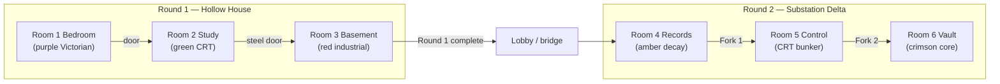

# 02 — Room Flow & Continuity (previous room → this room → next room)

Goal: the rooms feel like **one connected place** and nothing breaks at the seams.
Whichever room you upgrade, read **your** sheet and the sheets of the rooms next to yours.

## The big picture

Descent theme: **house → hidden study → containment cellar → sealed facility → vault.** Each room is
older, colder, and more industrial than the last. The player is always going *down*.

## Seam rules (apply to every room)

1. **Spawn/entry:** the room's `spawn` (in `rooms/<id>.js`) must put the player facing the room, near the entry door. Never spawn inside a prop/wall.
2. **Entry door ↔ previous room's exit door must look like the same door** (material/era), seen from the other side.
3. **Exit door** keeps its object ID and stays *locked until the backend says complete*. Locked door looks locked (chains/deadbolts/sealed); unlocked changes visibly via `engine.openDoor()`.
4. **Never gate or auto-advance a transition yourself.** Transitions are triggered by existing handlers in `Room*.jsx`/`App.jsx` (`onTransitionToRoom2/3`, `onProceedToLobby`, `onProceedToRoom5`, `ctc:navigate-room`).
5. **State persists on the server.** Reloading must return the player to the right room and state. If your GLB room needs a loading screen, show it, but never reset progress.
6. **Loading:** the room must be playable and the door/prompt logic live as soon as scene is ready; show a loading bar while GLBs stream. Load the shell first, props second, creatures last.
7. **Audio hand-off:** fade the previous ambience out/in (~1 s). Don't leave audio running after leaving the room (use existing dispose/cleanup).
8. **Visual continuity cues** (cheap, high impact): a recurring motif across neighbouring rooms (see sheets) — e.g. same wallpaper pattern trace, a shared symbol, a continuing water stain.
9. **No fourth-wall breaks or text** on props that contradict the story (`01` §5).

## Room sheets

### Room 1 — Lena's Bedroom (`bedroom`)
- **Previous:** none (round start, `at_start`). Coming from lobby/Round 1 intro (story book modal).
- **Next:** `study` via door (`room_door`/`door`) → `onTransitionToRoom2`.
- **Mood:** Victorian gothic, Halloween, moonlit purple (`#140d26 → #2b1d52`, accent `#8f7bff`, lamp `#ffcf8a`, moon `#9db8ff`). A child's room gone wrong, torn paper everywhere, temporal tear.
- **Ambient (content):** `amb_bedroom`, `music_box_faint`, `clock_tick`.
- **Must-have visuals for IDs:** four-poster bed, trunk with a lid, nightstand, wardrobe, desk, rocking chair, cracked mirror, doll, wall clock, window, portrait, poster, bookshelf, candle, lamp, pillows, music box, photo frame, diary, notebook.
- **Seam:** the exit door leads to a corridor to Daniel's study — hint of the study (green CRT glow under the door/through keyhole) when unlocked.
- **Hazards:** 2 decoy fragments → decoy props must look equally normal. `window` is a fragment prop here (can't be sealed shut).

### Room 2 — Daniel's Study (`study`)
- **Previous:** `bedroom`. Return door `study_door_back` goes back to the bedroom (must remain usable).
- **Next:** `basement` via `study_door_exit` / `exit_door` ("heavy steel door leading to Basement"); `onTransitionToRoom3`.
- **Mood:** green phosphor CRT hacker sanctuary (`#04120b → #0b2418`, accent `#3dff8b`), heavy mahogany, rain at the window, 60 Hz hum, scanline feel.
- **Must-have visuals for IDs:** CRT monitor, beige terminal PC tower, dot-matrix line printer with fan-fold paper, tablet in a locked desk drawer, reel-to-reel recorder, filing cabinet (4 drawers), corkboard with red string, sticky-note wall, armchair, radiator, floor lamp, wastebin, cable bundle, desk blotter, coat stand, bookshelf.
- **Seam:** palette shifts purple → green, tech era shifts 19th-century → 1980s. Carry one purple/Victorian trace (a portrait, a doily) so it feels like the same house.
- **Hazards:** frontend of this room is **actively developed by another contributor** — coordinate with the lead before touching `studyScene.js`. 16 fragments in strict order; props hold 2 fragments each (ES01+EK03 etc.) → a prop that "can't hold things" will confuse players.

### Room 3 — The Basement (`basement`)
- **Previous:** `study` (steel door down).
- **Next:** Round 1 complete → lobby (`onProceedToLobby`, `Round1VictoryModal`). Not another room.
- **Mood:** industrial containment bunker, concrete, red emergency strobe (`#14161a → #1f1115`, accent `#ff4d4d`, beacon `#ff2a2a`), steam, server fan hum, countdown clock, heartbeat that speeds up near the end.
- **Must-have visuals for IDs:** wall intercom, perforated server rack door with a yellow note, triple-screen containment console, 42U server rack, maintenance CRT terminal, red toolbox, 2 m circular floor seal/vault hatch with runes (decoy), 7-segment countdown monitor, steam pipes, barrels/crates, fuse box.
- **Seam:** the floor seal/vault hatch foreshadows Round 2 (the "sealed below"). Make it look ominous.
- **Hazards:** final terminal is 3-stage (keywords → photo ordering → protocol+PIN): don't obstruct the screens. `wall_monitor` countdown visual must show the **real timer** only if existing code does; don't invent a fake clock.

### Room 4 — The Rotting Archive (`records`)
- **Previous:** Round 1 bridge/lobby → Round 2 start (`at_start`).
- **Next:** **Fork 1** (two arches: Auxiliary/Primary wing, rotary selector) → Room 5. `bulkhead_door` (R2-07) = sealed + chained, opens when solved. Fork logic exists (`Fork1Modal`, `/fork/...`) — don't change it.
- **Mood:** flooded sub-basement, low ceiling, corroded dripping pipes, standing black water, bowing metal shelves with waterlogged boxes, half the fluorescents dead, two flickering, one buzzing wrongly. Palette: decay (`#1e1b14 → #2d2818`, accent `#e7c97a`, amber `#c47a00`, dried-blood stains).
- **Must-have visuals for IDs:** yellowed incident folder, microfilm reader, event-card whiteboard (timeline board), heavy chained bulkhead door, 2 filing cabinets (A, B), archive shelves with boxes, clerk's desk, card catalog, waste basket, vent grate, flickering ceiling light, flashlight + battery pack pickups.
- **Seam:** this is where the story pivots: Corvin's facility. First hints of his name/badge/1983 *only through backend fragments*, never baked into textures.
- **Hazards:** existing flashlight battery logic lives in `Room4Records.jsx` — your torch visuals must hook into `E.flashlight` as it exists, not replace the logic.

### Room 5 — Control (`control`) — DONE
Use it as the visual benchmark. **Do not edit.** Its entry comes from Room 4's Fork 1; its exit is Fork 2 → Vault.

### Room 6 — Vault (`vault`) — Swapnil
No fragments, no basket, torch dies on entry. Receives all carried evidence through the dossier.

## Continuity motifs (suggested, optional but recommended)

| Motif | Where |
|---|---|
| Recurring tear/stain/cracked-glass mark that grows each room | R1 → R6 |
| Same warning sign style / door plaque style | R3, R4, R5, R6 |
| Old-world (Victorian) objects shrink, 1980s tech grows | R1 → R5 |
| Water: dry (R1) → damp (R3) → flooded (R4) → dry-cold (R5) | atmosphere |
| Light: warm lamp → CRT green → red strobe → amber tubes → CRT blue → crimson pulse | color arc |

## Seam checklist (tick per PR)

- [ ] Entered from previous room naturally; spawn is safe and faces the room
- [ ] Back-door (study only) still returns to previous room
- [ ] Exit door locked until backend completion, then opens, then next room loads
- [ ] Reload mid-room restores server state
- [ ] Previous room's audio does not bleed in; this room's audio stops on exit
- [ ] Palette/mood matches this room's sheet (not your favourite colour)
- [ ] No text/numbers on props that can be read as clues
